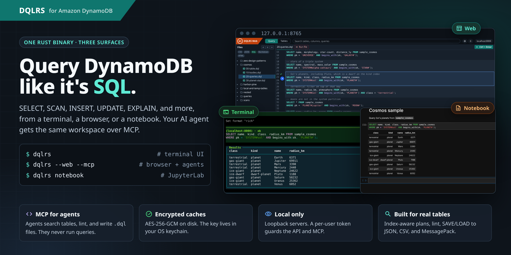
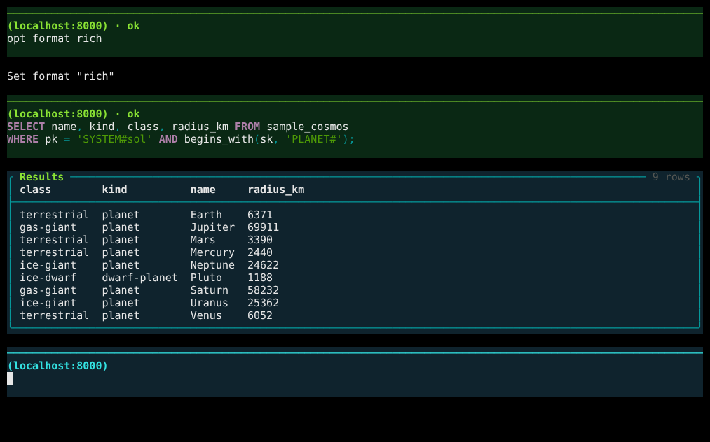
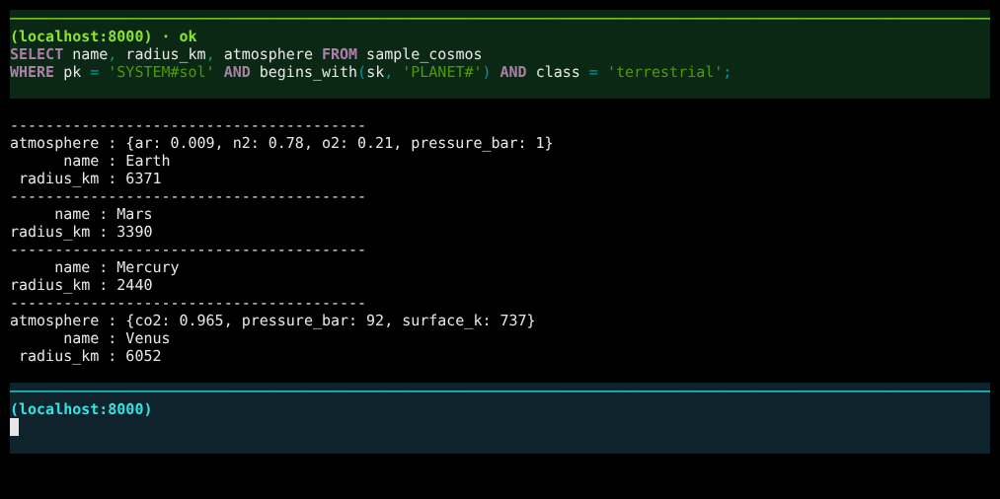
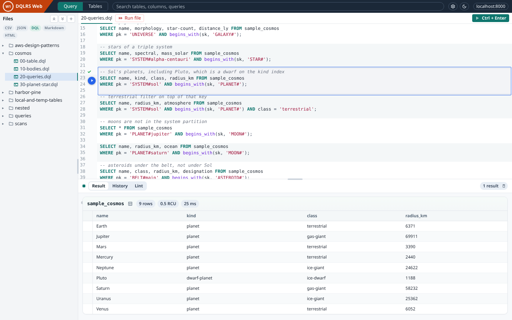
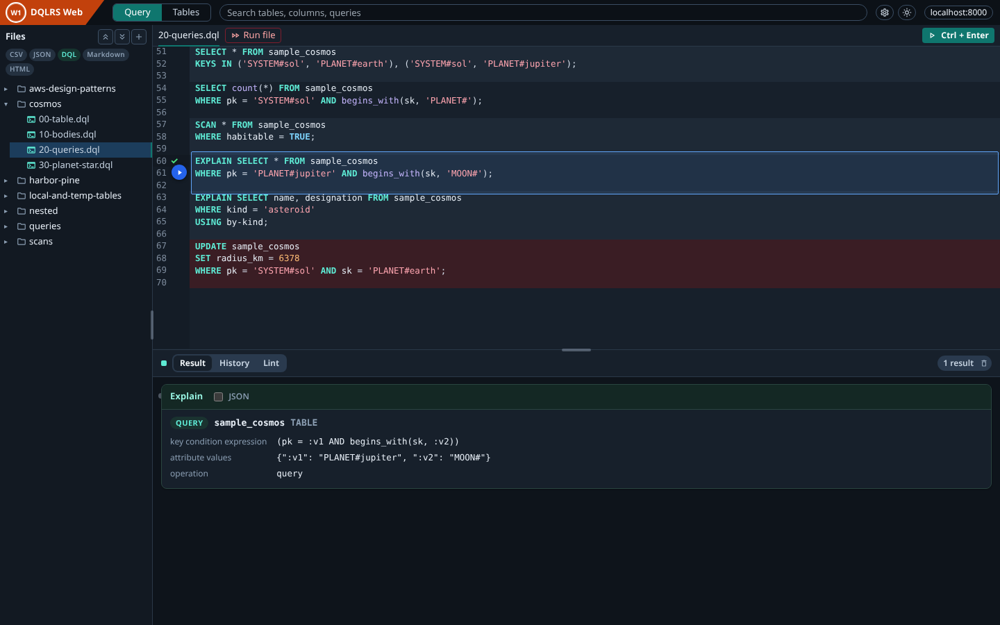
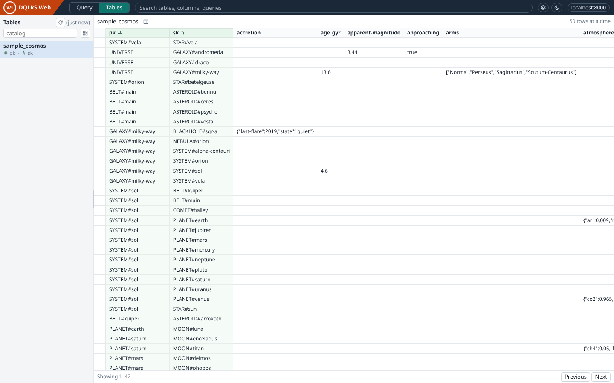
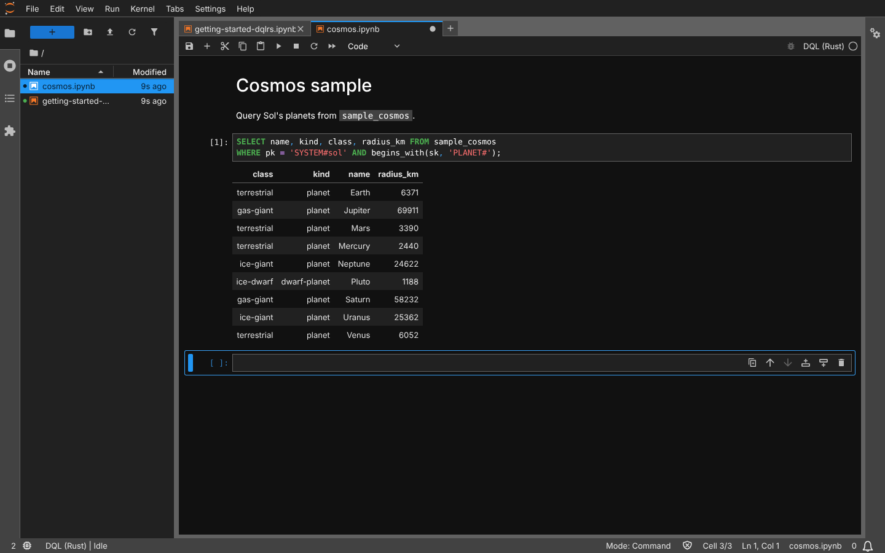
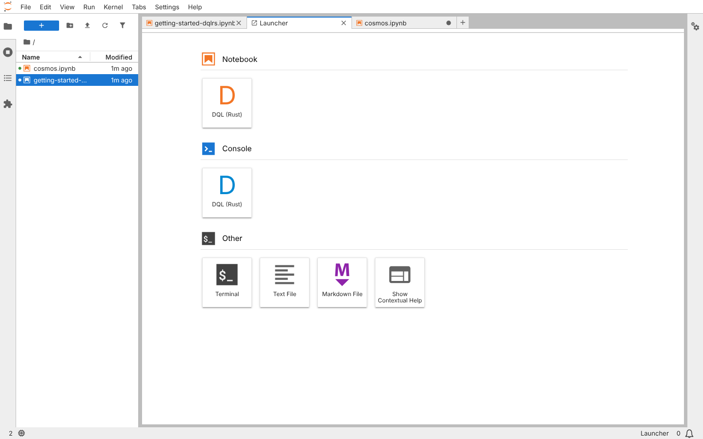

<p align="center">
  
</p>

# DQL & DQLRS

**Query Amazon DynamoDB like it's SQL.** `dqlrs` is one Rust binary with three
ways to work: a terminal UI, a browser editor, and a JupyterLab notebook. Your
AI agent can use the same workspace over MCP.

```bash
cargo install --git https://github.com/jspreddy/dql.git --branch v-rust \
  --locked --root ~/.local dql-cli
```

Needs [Rust/Cargo](https://rustup.rs/). The binary lands in `~/.local/bin`.
More options: [Install](#install).

Pick a surface:

- [**Terminal UI**](#repl): an interactive REPL with rich tables.
- [**Web editor**](#web-ui): `.dql` files, lint, `EXPLAIN` cards, a table
  browser, and MCP for agents.
- [**Notebook**](#notebook): JupyterLab with a DQL (Rust) kernel.
- [**One-shot commands**](#run-a-query-from-the-cli): `-c` and `--json` for
  scripts.

`dqlrs` uses the standard AWS credential chain. To keep long-lived keys out of
`~/.aws/credentials`, store them with
[aws-vault](https://github.com/99designs/aws-vault) and run
`aws-vault exec <profile> -- dqlrs`. Point any surface at
[DynamoDB Local](https://docs.aws.amazon.com/amazondynamodb/latest/developerguide/DynamoDBLocal.html)
with `-H localhost -p 8000`. See [Credentials](#credentials).

## Why dqlrs

- **More than PartiQL.** `SELECT`, `SCAN`, `INSERT`, `UPDATE`, `DELETE`,
  `CREATE` / `ALTER` / `DROP TABLE`, `EXPLAIN`, `ANALYZE`, `DUMP SCHEMA`, and
  `SAVE` / `LOAD`. [PartiQL for
  DynamoDB](https://docs.aws.amazon.com/amazondynamodb/latest/developerguide/ql-reference.html)
  covers only a thin slice of everyday table work.
- **Index-aware.** Picks the table or index for your `WHERE`, and `EXPLAIN`
  shows the plan before you spend capacity.
- **Three surfaces, one binary.** A rich terminal UI, a web editor with a file
  tree, lint, and a table browser, and a notebook kernel. Nothing else to run.
- **MCP for agents.** `dqlrs web --mcp` lets an agent search tables, read
  schemas, lint, and write `.dql` files. It cannot run queries.
- **Secure by default.** Table and result caches are sealed with AES-256-GCM,
  with the key in your OS keychain. Servers listen on loopback only, and a
  per-user token guards the web API, MCP, and TCP `--serve`.

## Screenshots

More shots live under [`screenshots/cli/`](screenshots/cli/),
[`screenshots/web/`](screenshots/web/), and
[`screenshots/notebook/`](screenshots/notebook/).

### REPL

```bash
dqlrs
dqlrs -H localhost -p 8000
```

`opt format rich` draws results as a table:



The default `smart` format switches to one block per item when a row has nested
maps:



### Web UI

```bash
dqlrs web
dqlrs web -H localhost -p 8000 --dir ~/queries
```

Opens `http://127.0.0.1:8765` by default. The server is the `dqlrs` binary;
the browser assets are bundled into it.

- **Query:** `.dql` file tree on the left, CodeMirror editor with DQL
  highlighting and lint, and Result / History / Lint tabs under it. Run the
  statement at the cursor (Ctrl+Enter) or the whole file.
- **Tables:** every table with its keys, 50 rows at a time.
- Search across tables, columns, and queries, and a light or dark theme.
- `--mcp` also serves MCP tools at `/mcp` on the same host.



`EXPLAIN` shows the plan as a card, with a JSON toggle:



The table browser:



Details: [`dqlrs-web/README.md`](dqlrs-web/README.md).

### Notebook

```bash
dqlrs notebook
dqlrs notebook --local
```

JupyterLab with a **DQL (Rust)** kernel. The first run installs JupyterLab into
`~/.local/share/dqlrs/notebook` (needs Python 3.10+ or
[uv](https://docs.astral.sh/uv/)) and writes a `getting-started-dqlrs.ipynb`
starter into the current folder. `--local` points cells at DynamoDB Local.



The launcher lists the DQL (Rust) notebook and console:



## Supported queries

| Statement | Purpose |
| --- | --- |
| `CREATE TABLE` / `DROP TABLE` | Schema (+ `IF NOT EXISTS` / `IF EXISTS`) |
| `INSERT` | Put items |
| `SELECT` | Query by key / index |
| `SCAN` | Table or index scan (same clauses as `SELECT`) |
| `UPDATE` / `DELETE` | Mutate or remove items |
| `ALTER TABLE` | Throughput and global indexes |
| `SHOW TABLES` / `ST` | List tables: `LIKE 'a%'` globs, or `ST post` for names containing `post` |
| `DESCRIBE` | Table description |
| `DUMP SCHEMA` | Emit `CREATE TABLE` DDL |
| `LOAD` / `SAVE` | Import / export `.json`, `.csv`, `.msgpack` (+ `.gz`) |
| `EXPLAIN` / `ANALYZE` | Plan and capacity |

**Where filters:** `= != <> < <= > >=`, `BETWEEN`, `IN`, `AND` / `OR` / `NOT`,
`begins_with`, `contains`, `attribute_exists`, `attribute_not_exists`,
`attribute_type`, `size(…)`.

**Update ops:** `SET`, `ADD`, `REMOVE`, `DELETE`, plus `if_not_exists` and
`list_append`.

In the REPL: `help` or `help <statement>`.

## Install

Both clients install straight from the **`v-rust`** branch on GitHub. There
are no prebuilt binaries or releases yet.

### Rust `dqlrs` (recommended)

Requires [Rust/Cargo](https://rustup.rs/). This builds `dqlrs` from source:

```bash
cargo install --git https://github.com/jspreddy/dql.git --branch v-rust \
  --locked --root ~/.local dql-cli
```

Add `~/.local/bin` to your `PATH` if needed. The binary is `dqlrs`.

More: [`rust-docs/README.md`](rust-docs/README.md).

### Python `dql`

Requires Python 3.9–3.11 and [uv](https://docs.astral.sh/uv/).

```bash
curl -LsSf https://astral.sh/uv/install.sh | sh
uv tool install --python 3.9 \
  "git+https://github.com/jspreddy/dql.git@v-rust#subdirectory=py-impl"
```

Language docs: [`py-docs/topics/getting_started.rst`](py-docs/topics/getting_started.rst).

## Run a query from the CLI

Use `-c` / `--command` to run DQL (or a meta-command) and exit — no REPL:

```bash
dqlrs -H localhost -p 8000 -c \
  "SELECT name, kind, class, radius_km FROM sample_cosmos
   WHERE pk = 'SYSTEM#sol' AND begins_with(sk, 'PLANET#');"

dqlrs --json -c "SCAN * FROM sample_cosmos WHERE habitable = TRUE LIMIT 5"
dqlrs -H localhost -p 8000 -c "ls"
```

`--json` only applies with `-c`. Point at DynamoDB Local with `-H` / `-p`, or
omit `-H` for live AWS.

## Compare the three surfaces

| | REPL | Web (`dqlrs web`) | Notebook |
| --- | :---: | :---: | :---: |
| Interactive DQL | Yes (TUI) | Yes (editor) | Yes (cells) |
| One-shot / scripts | `-c` outside the REPL | Run file | Cells (or `-c` via kernel) |
| Table browser | `ls` / `SHOW` / `DESCRIBE` | Tables view, 50 rows a page | Via statements |
| `.dql` files | `file <path>` | File tree: create, rename, move, run | Jupyter file browser |
| Multi-cell workflows | — | — | Yes |
| `EXPLAIN` UI | Text plan | Plan card + JSON toggle | As DQL in a cell |
| Meta-commands (`opt`, `whoami`, …) | Full set | Session via server | Kernel / magics |
| Lint | — | Lint tab and underlines | — |
| History | `~/.dql/history` | History tab (this page) | Jupyter history |

## Credentials

Same as the AWS CLI: `~/.aws/credentials` or `AWS_ACCESS_KEY_ID` /
`AWS_SECRET_ACCESS_KEY`. Default region is `us-west-1` (`AWS_REGION` or `-r`).

[aws-vault](https://github.com/99designs/aws-vault) keeps your AWS keys in the
OS keychain instead of a plaintext file. It hands `dqlrs` short-lived session
credentials through the environment:

```bash
aws-vault add <profile>                      # once: store the keys
aws-vault exec <profile> -- dqlrs            # terminal UI
aws-vault exec <profile> -- dqlrs web        # web editor
aws-vault exec <profile> -- dqlrs notebook   # notebook
```

| Mode | How |
| --- | --- |
| Live AWS | `dqlrs` (no `-H`) |
| DynamoDB Local | `dqlrs -H localhost -p 8000` |
| In-memory | `DQL_BACKEND=memory dqlrs …` |

In the REPL: `whoami`, `local [host] [port]`, `use <region>`. Config:
`~/.config/dql.json`.

## Examples

Cosmos sample (table + bodies + queries):

```sql
CREATE TABLE sample_cosmos (
  pk STRING HASH KEY,
  sk STRING RANGE KEY
) GLOBAL INDEX ('by-kind', kind STRING, name STRING);

SELECT name, kind, class, radius_km FROM sample_cosmos
WHERE pk = 'SYSTEM#sol' AND begins_with(sk, 'PLANET#');

SELECT pk, sk, name, radius_km FROM sample_cosmos
WHERE kind = 'moon'
USING by-kind;

SCAN * FROM sample_cosmos WHERE habitable = TRUE;

EXPLAIN SELECT * FROM sample_cosmos
WHERE pk = 'PLANET#jupiter' AND begins_with(sk, 'MOON#');
```

## Documentation

| Where | What |
| --- | --- |
| [`rust-docs/`](rust-docs/README.md) | `dqlrs` user guide: flags, `--serve`, notebook, SAVE/LOAD, migration from Python, architecture |
| [`rust-docs/plans/`](rust-docs/plans/README.md) | Architecture notes, open design debt, archive of finished plans (including the security design) |
| [`dqlrs-web/`](dqlrs-web/README.md) | Web UI behavior and Playwright tests |
| [`notebook/`](notebook/README.md) | JupyterLab setup from a checkout (Python and Rust kernels) |
| [`py-docs/`](py-docs/) | Python `dql` docs (Sphinx) |
| [`screenshots/`](screenshots/README.md) | The images on this page |
| [`CHANGELOG.md`](CHANGELOG.md) | What changed in each version (generated from `v-rust`) |
| [`MAINTAINER.md`](MAINTAINER.md) | Repository layout, builds, releases |

## About this fork

`dqlrs` (Rust) is the primary client. `dql` (Python) remains available for the
original CLI and for places Rust is not a fit. Both speak the same DQL language
and can be installed side by side.

This repository ([jspreddy/dql](https://github.com/jspreddy/dql)) is a fork of
[stevearc/dql](https://github.com/stevearc/dql). Use this repo for source
and issues. The PyPI package `dql` and
[Read the Docs](http://dql.readthedocs.org/) still ship from upstream.
