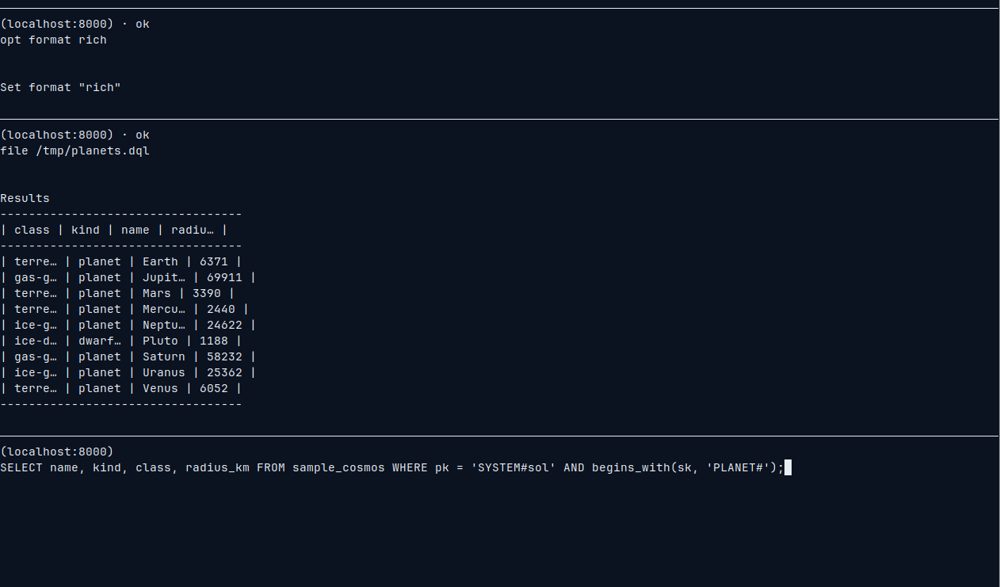
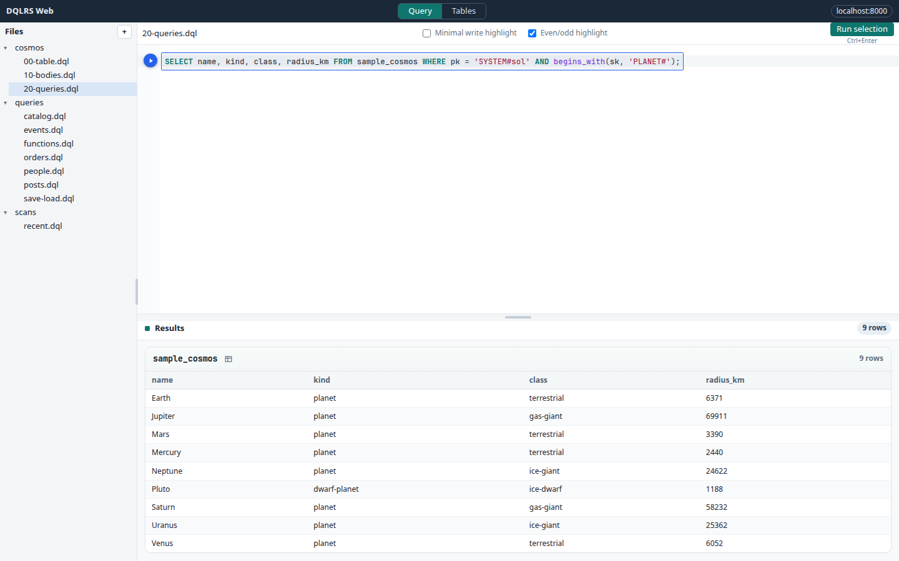
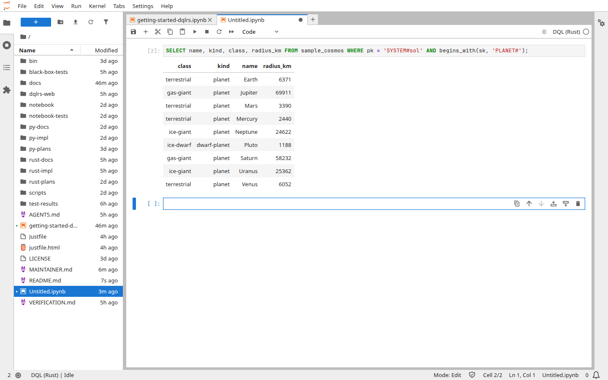

# DQL & DQLRS

SQL-ish queries for Amazon DynamoDB — richer than [PartiQL for
DynamoDB](https://docs.aws.amazon.com/amazondynamodb/latest/developerguide/ql-reference.html),
which covers only a thin slice of everyday table work.

`dqlrs` (Rust) is the primary client. `dql` (Python) remains available for the
original CLI and for places Rust is not a fit. Both speak the same DQL language
and can be installed side by side.

This repository ([jspreddy/dql](https://github.com/jspreddy/dql)) is a fork of
[stevearc/dql](https://github.com/stevearc/dql). Use this repo for source,
issues, and GitHub releases. The PyPI package `dql` and
[Read the Docs](http://dql.readthedocs.org/) still ship from upstream.

## Supported queries

| Statement | Purpose |
| --- | --- |
| `CREATE TABLE` / `DROP TABLE` | Schema (+ `IF NOT EXISTS` / `IF EXISTS`) |
| `INSERT` | Put items |
| `SELECT` | Query by key / index |
| `SCAN` | Table or index scan (same clauses as `SELECT`) |
| `UPDATE` / `DELETE` | Mutate or remove items |
| `ALTER TABLE` | Throughput and global indexes |
| `SHOW TABLES` / `SHOW TABLES LIKE` | List tables (`%` / `_` globs) |
| `DESCRIBE` | Table description |
| `DUMP SCHEMA` | Emit `CREATE TABLE` DDL |
| `LOAD` / `SAVE` | Import / export `.json`, `.csv`, `.msgpack` (+ `.gz`) |
| `EXPLAIN` / `ANALYZE` | Plan and capacity |

**Where filters:** `= != <> < <= > >=`, `BETWEEN`, `IN`, `AND` / `OR` / `NOT`,
`begins_with`, `contains`, `attribute_exists`, `attribute_not_exists`,
`attribute_type`, `size(…)`.

**Update ops:** `SET`, `ADD`, `REMOVE`, `DELETE`, plus `if_not_exists` and
`list_append`.

In the REPL: `help` or `help <statement>`.

## Install

Install from the **`v-rust`** branch on GitHub.

### Rust `dqlrs` (recommended)

Requires [Rust/Cargo](https://rustup.rs/).

```bash
cargo install --git https://github.com/jspreddy/dql.git --branch v-rust \
  --locked --root ~/.local dql-cli
```

Add `~/.local/bin` to your `PATH` if needed. The binary is `dqlrs`.

More: [`rust-docs/README.md`](rust-docs/README.md).

### Python `dql`

Requires Python 3.9–3.11 and [uv](https://docs.astral.sh/uv/).

```bash
curl -LsSf https://astral.sh/uv/install.sh | sh
uv tool install --python 3.9 \
  "git+https://github.com/jspreddy/dql.git@v-rust#subdirectory=py-impl"
```

Language docs: [`py-docs/topics/getting_started.rst`](py-docs/topics/getting_started.rst).

## Run a query from the CLI

Use `-c` / `--command` to run DQL (or a meta-command) and exit — no REPL:

```bash
dqlrs -H localhost -p 8000 -c \
  "SELECT name, kind, class, radius_km FROM sample_cosmos
   WHERE pk = 'SYSTEM#sol' AND begins_with(sk, 'PLANET#');"

dqlrs --json -c "SCAN * FROM sample_cosmos WHERE habitable = TRUE LIMIT 5"
dqlrs -H localhost -p 8000 -c "ls"
```

`--json` only applies with `-c`. Point at DynamoDB Local with `-H` / `-p`, or
omit `-H` for live AWS.

## Screenshots

### REPL

```bash
dqlrs
dqlrs -H localhost -p 8000
```



### Web UI

```bash
dqlrs --web
dqlrs --web -H localhost -p 8000 --dir ~/queries
```

Query editor, `.dql` file tree, table browser — default
`http://127.0.0.1:8765`.



### Notebook

```bash
dqlrs notebook
dqlrs notebook --local
```

JupyterLab with a **DQL (Rust)** kernel.



## Compare the three surfaces

| | REPL | Web (`--web`) | Notebook |
| --- | :---: | :---: | :---: |
| Interactive DQL | Yes (TUI) | Yes (editor) | Yes (cells) |
| One-shot / scripts | `-c` outside the REPL | — | Cells (or `-c` via kernel) |
| Table browser | `ls` / `SHOW` / `DESCRIBE` | Tables nav + sample rows | Via statements |
| `.dql` files | `file <path>` | Left nav create/edit/run | Jupyter file browser |
| Multi-cell workflows | — | — | Yes |
| `EXPLAIN` UI | Text plan | Plan card + JSON toggle | As DQL in a cell |
| Meta-commands (`opt`, `whoami`, …) | Full set | Session via server | Kernel / magics |
| History | `~/.dql/history` | — | Jupyter history |

## Credentials

Same as the AWS CLI: `~/.aws/credentials` or `AWS_ACCESS_KEY_ID` /
`AWS_SECRET_ACCESS_KEY`. Default region is `us-west-1` (`AWS_REGION` or `-r`).

```bash
aws-vault exec <profile> -- dqlrs
```

| Mode | How |
| --- | --- |
| Live AWS | `dqlrs` (no `-H`) |
| DynamoDB Local | `dqlrs -H localhost -p 8000` |
| In-memory | `DQL_BACKEND=memory dqlrs …` |

In the REPL: `whoami`, `local [host] [port]`, `use <region>`. Config:
`~/.config/dql.json`.

## Examples

Cosmos sample (table + bodies + queries):

```sql
CREATE TABLE sample_cosmos (
  pk STRING HASH KEY,
  sk STRING RANGE KEY
) GLOBAL INDEX ('by-kind', kind STRING, name STRING);

SELECT name, kind, class, radius_km FROM sample_cosmos
WHERE pk = 'SYSTEM#sol' AND begins_with(sk, 'PLANET#');

SELECT pk, sk, name, radius_km FROM sample_cosmos
WHERE kind = 'moon'
USING by-kind;

SCAN * FROM sample_cosmos WHERE habitable = TRUE;

EXPLAIN SELECT * FROM sample_cosmos
WHERE pk = 'PLANET#jupiter' AND begins_with(sk, 'MOON#');
```

Maintainer notes live in [`MAINTAINER.md`](MAINTAINER.md).
