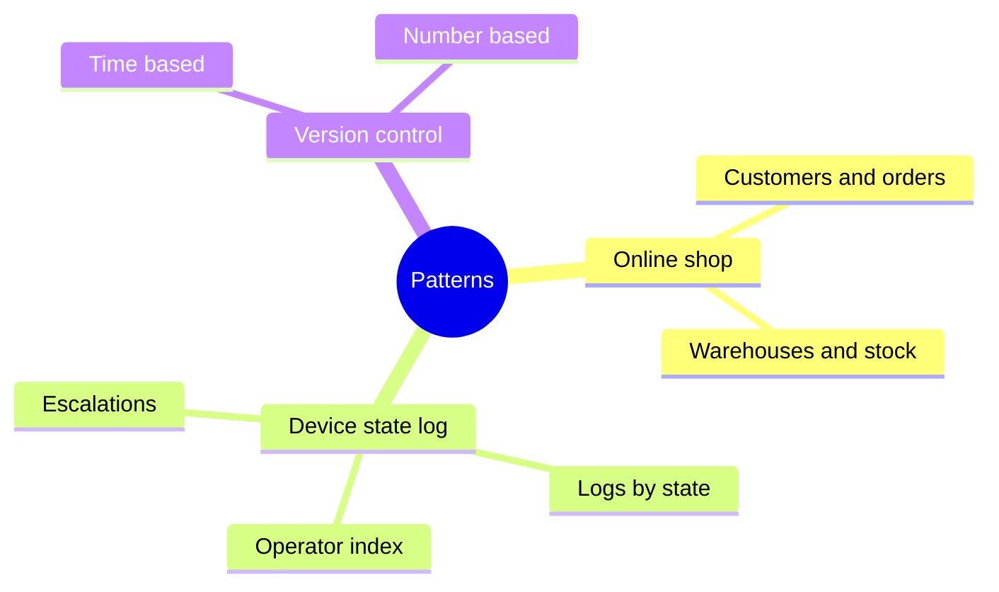

# AWS design patterns

Three single-table designs from the [amazon-dynamodb-design-patterns](https://github.com/aws-samples/amazon-dynamodb-design-patterns) sample. Each folder has a DQL script that loads the rows and runs the access patterns.

| Example | What the table holds | Script |
| --- | --- | --- |
| [Online shop](an-online-shop/README.md) | Customers, products, warehouses, orders, invoices, and shipments | [online-shop.dql](an-online-shop/online-shop.dql) |
| [Device state log](device-state-log/README.md) | Device warnings and normal readings, plus who handled them | [device-state-log.dql](device-state-log/device-state-log.dql) |
| [Version control](version-control/README.md) | Equipment metadata and a history of states | [time-based](version-control/time-based/equipment.dql) and [number-based](version-control/number-based/README.md) |

In the dqlrs web UI, use the full-screen button to enlarge the diagram.
