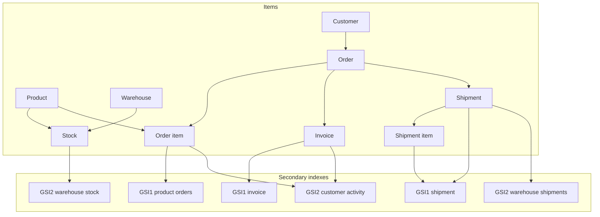

# Online shop

Customers, products, warehouses, orders, invoices, and shipments share one table. A row's key prefix says which of those it is.

This is the [AWS online shop example](https://github.com/aws-samples/amazon-dynamodb-design-patterns/tree/master/examples/an-online-shop). The script is [online-shop.dql](online-shop.dql). Its inserts are the final NoSQL Workbench sample rows.

## Keys

The sample table is `OnlineShop`. The script creates `aws_shop`.

| Key | Attribute |
| --- | --- |
| Partition key | `PK` |
| Sort key | `SK` |
| GSI1 | `GSI1-PK`, `GSI1-SK` |
| GSI2 | `GSI2-PK`, `GSI2-SK` |

| Prefix | Item | Partition key | Sort key |
| --- | --- | --- | --- |
| `c#` | Customer | `c#` customer id | same customer id |
| `p#` | Product | `p#` product id | same product id |
| `w#` | Warehouse | `w#` warehouse id | same warehouse id |
| `p#` / `w#` | Stock | product id | warehouse id |
| `o#` | Order | `o#` order id | customer id |
| `o#` / `p#` | Order item | order id | product id |
| `o#` / `i#` | Invoice | order id | `i#` invoice id |
| `o#` / `sh#` | Shipment | order id | `sh#` shipment id |
| `o#` / `shp#` | Shipment item | order id | `shp#` line id |

An order and everything that belongs to it share the order id as `PK`: the order row, its lines, its invoice, its shipments, and the shipment lines. `begins_with(SK, 'sh#')` matches shipments. It does not match shipment lines, because those start with `shp#`.

## Indexes

GSI1 answers questions that start from a product, an invoice id, or a shipment id.

| Item | GSI1 partition | GSI1 sort |
| --- | --- | --- |
| Order item | product id | order time |
| Invoice | invoice id | invoice id |
| Shipment | shipment id | shipment id |
| Shipment item | shipment id | product id |

GSI2 answers questions that start from a warehouse or a customer.

| Item | GSI2 partition | GSI2 sort |
| --- | --- | --- |
| Stock | warehouse id | product id |
| Shipment | warehouse id | shipment id |
| Order item | customer id | order time |
| Invoice | customer id | invoice time |

Stock for The Book in the Boras warehouse (`p#99887`, `w#12376`) has a quantity and no GSI2 keys. The warehouse index does not list it. The base table still has the row.

Payments are not their own items. Invoice `i#55443` stores them on `Detail.Payments`: a gift card for 100 and a card payment for 300.

## Rows in the script

Samaneh (`c#12345`), Kathleen, and Henrik are the customers. The album (`p#12345`, price 100) and The Book (`p#99887`, price 40) are the products. Warehouses are Goteborg (`w#12345`) and Boras (`w#12376`). Order `o#12345` is Samaneh's. It has both products, invoice `i#55443` for 400, and two express shipments, `sh#88899` from Boras and `sh#98765` from Goteborg.

## Diagram

A box is an item or an index. An arrow means the item on the left is stored with, or copied into, the one on the right.

In the dqlrs web UI, hover a box to follow that chain, click a box to pin it, and use the full-screen button to enlarge the diagram.

## Access patterns in the script

- Customer, product, and warehouse by their own id.
- Warehouses that stock a product, from the product partition.
- Stock in a warehouse, from GSI2. The Boras row above is read from the base table.
- The whole order partition, then its lines, invoice, and shipments by sort-key prefix.
- Orders for a product in a date range, from GSI1.
- One invoice by invoice id, from GSI1, including the payments map.
- One shipment and the products on it, from GSI1.
- Shipments leaving a warehouse, from GSI2.
- A customer's invoice on a given day, from GSI2.
