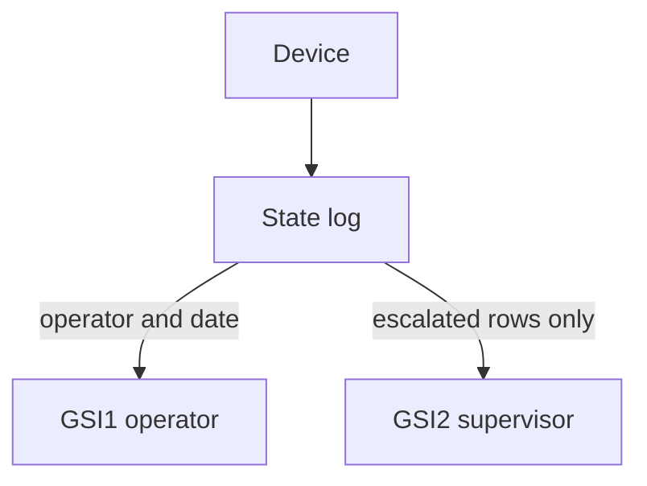

# Device state log

Each row is one reading: a device, a state, a time, and the operator who recorded it. Escalated readings also name a supervisor.

This is the [AWS device state log example](https://github.com/aws-samples/amazon-dynamodb-design-patterns/tree/master/examples/device-state-log). The script is [device-state-log.dql](device-state-log.dql). Its inserts are the final NoSQL Workbench sample rows.

## Keys

The sample table is `DeviceStateLog`. The script creates `aws_device_log`.

| Key | Sample attribute | Attribute in the script |
| --- | --- | --- |
| Partition key | `DeviceID` | `DeviceID` |
| Sort key | `State#Date` | `state_date` |
| GSI1 | `Operator`, `Date` | `Operator`, `Date` |
| GSI2 | `EscalatedTo`, `State#Date` | `EscalatedTo`, `state_date` |

The sample sort key is `State#Date`. A DQL name cannot contain `#`, so the script calls it `state_date`. The value is unchanged: `STATE#timestamp`, for example `WARNING1#2020-04-24T14:50:00`.

That value groups one device's readings by state, and within a state it sorts by time. `begins_with(state_date, 'WARNING1#')` is every WARNING1 reading. Descending order on that prefix is the newest warning first. A query of the whole device sorts by the state name first, because the state is the front of the key.

GSI2 is sparse. A row is in that index only when `EscalatedTo` is set. In this data, one reading is escalated, to Sara.

## Rows in the script

| Device | What happened |
| --- | --- |
| `d#12345` | Three WARNING1 readings, then NORMAL. Liz recorded all four on 24 April 2020. |
| `d#54321` | WARNING3, then NORMAL, with Liz. Earlier that morning Sue recorded WARNING2 and a WARNING3. |
| `d#11223` | Two WARNING4 readings by Sue on 27 April 2020. The later one is escalated to Sara. |

## Diagram

The device owns its log rows. Those rows are copied to the operator index, and an escalated row is copied to the supervisor index.

In the dqlrs web UI, hover a box to follow that chain, click a box to pin it, and use the full-screen button to enlarge the diagram.

## Access patterns in the script

- All readings for `d#12345`, ordered by `state_date`.
- WARNING1 readings for that device, newest warning first.
- Liz's readings on 24 April 2020, from GSI1, ordered by `Date`.
- Readings escalated to Sara, from GSI2.
- Sara's WARNING4 readings on 27 April 2020, from GSI2, using the state prefix on `state_date`.
