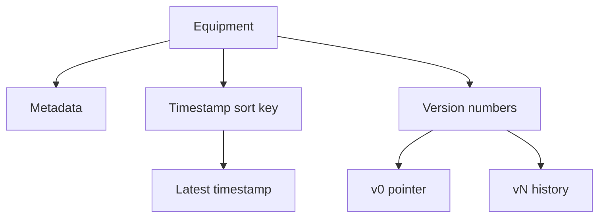

# Version control

One equipment item has a metadata row and a history of states. Two key designs keep that history.

This is the [AWS version control example](https://github.com/aws-samples/amazon-dynamodb-design-patterns/tree/master/examples/version-control). Both designs are described in [Implementing version control using Amazon DynamoDB](https://aws.amazon.com/blogs/database/implementing-version-control-using-amazon-dynamodb/).

| Design | Sort key | Latest state | Script |
| --- | --- | --- | --- |
| [Time-based](time-based/README.md) | The timestamp | The greatest timestamp | [equipment.dql](time-based/equipment.dql) |
| [Number-based](number-based/README.md) | `v0`, `v1`, `v2`, … | The `v0` row | [three write techniques](number-based/README.md) |

The partition key is the equipment id, such as `Equipment#1`. Metadata uses sort key `Metadata` in both designs. The sample fields on that row are `Name`, `FactoryID`, and `LineID`.

In the dqlrs web UI, hover a box to follow that chain, click a box to pin it, and use the full-screen button to enlarge the diagram.
