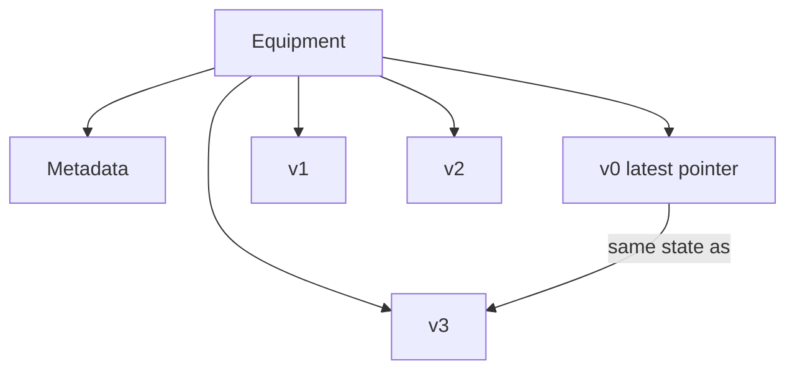

# Number-based versions

The latest state lives on sort key `v0`. Each older write also has its own row, `v1`, `v2`, `v3`, and so on. `v0` carries `Latest`, the number of the newest version, plus the current `Time` and `State`.

This is the [AWS number-based version example](https://github.com/aws-samples/amazon-dynamodb-design-patterns/tree/master/examples/version-control/number-based-version). The parent model is [version control](../README.md). The stored rows are the same in all three folders. The folders differ in how a new version is written:

| Folder | How a new version is written | AWS sample |
| --- | --- | --- |
| [Atomic counters](atomic-counters/README.md) | Increment `Latest` on `v0`, then put `vN` | [atomic-counters](https://github.com/aws-samples/amazon-dynamodb-design-patterns/tree/master/examples/version-control/number-based-version/atomic-counters) |
| [Transactional write](transactional-write/README.md) | Update `v0` and put `vN` in one transaction | [transactional-write](https://github.com/aws-samples/amazon-dynamodb-design-patterns/tree/master/examples/version-control/number-based-version/transactional-write) |
| [DynamoDB streams](dynamodb-streams/README.md) | The client updates `v0`. A stream consumer writes `vN` | [dynamodb-streams](https://github.com/aws-samples/amazon-dynamodb-design-patterns/tree/master/examples/version-control/number-based-version/dynamodb-streams) |

## Keys

Partition key `PK`, sort key `SK`. No secondary index.

| Row | SK | Attributes |
| --- | --- | --- |
| Equipment | `Metadata` | `Name`, `FactoryID`, `LineID` |
| Latest pointer | `v0` | `Time`, `State`, `Latest` |
| History | `v1`, `v2`, `v3`, … | `Time`, `State` |

The sample reads the latest state with a get of `SK = 'v0'`. History in the scripts is `SK BETWEEN 'v1' AND 'v9'`, which matches the single-digit versions these rows use.

The scripts insert the table after version 3 has landed. They do not run the counter, the transaction, or the stream.

## Rows in the scripts

Equipment#1 ends at WARNING2, `2020-11-11T08:15:00`, with `Latest` 3. Its history is WARNING1, then NORMAL, then WARNING2. Equipment#2 has `Latest` 1 and one NORMAL reading, `2020-11-12T07:00:00`.

## Diagram

`v0` and the numbered rows are siblings under the equipment. `v0` stores the same state as the newest history row.

In the dqlrs web UI, hover a box to follow that chain, click a box to pin it, and use the full-screen button to enlarge the diagram.
