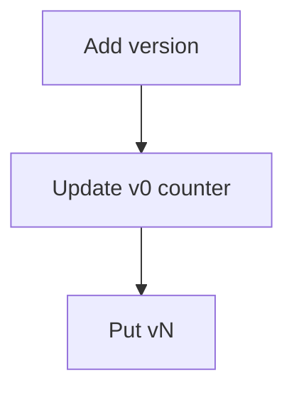

# Atomic counter

A new version is two writes. The first updates `v0`: set `Time` and `State`, and add 1 to `Latest`, starting from 0 when the attribute is missing. The returned `Latest` becomes N. The second write puts `vN` with that time and state.

This is the [AWS atomic-counters example](https://github.com/aws-samples/amazon-dynamodb-design-patterns/tree/master/examples/version-control/number-based-version/atomic-counters).

The stored rows match the [number-based model](../README.md): `Metadata`, `v0` with `Latest`, and `v1` onward. The script is [equipment.dql](equipment.dql). It loads the table after version 3 has landed.

The two writes are separate calls. If the process stops after the first, `v0` says a version exists that the history rows do not contain yet.

## Diagram

The client updates the pointer, and that update is what the history row is numbered from.

In the dqlrs web UI, hover a box to follow that chain, click a box to pin it, and use the full-screen button to enlarge the diagram.
