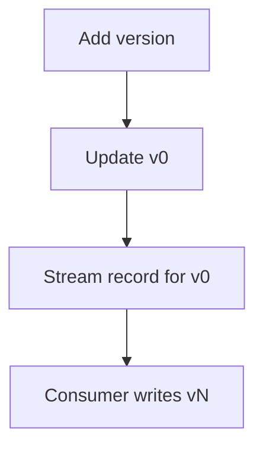

# DynamoDB streams

The client writes only `v0`. It sets `Time` and `State`, and adds 1 to `Latest`. The table stream delivers that new image. The consumer ignores records whose sort key is not `v0`, and puts `vN` from the image, where N is the new `Latest`.

This is the [AWS DynamoDB streams example](https://github.com/aws-samples/amazon-dynamodb-design-patterns/tree/master/examples/version-control/number-based-version/dynamodb-streams).

The stored rows match the [number-based model](../README.md): `Metadata`, `v0` with `Latest`, and `v1` onward. The script is [equipment.dql](equipment.dql). It loads the table after version 3 has landed.

Until the consumer runs, the history row for the new version is absent and `v0` already shows it.

## Diagram

The client updates the pointer. The stream record for that pointer is what creates the history row.

In the dqlrs web UI, hover a box to follow that chain, click a box to pin it, and use the full-screen button to enlarge the diagram.
