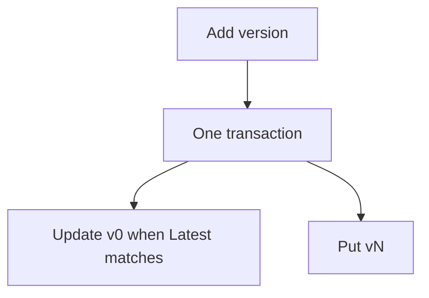

# Transactional write

A new version reads `Latest` from `v0`, then updates `v0` and puts `vN` together. The update is accepted when `Latest` is missing or still equals the value just read. The new `Latest` is that value plus one.

This is the [AWS transactional-write example](https://github.com/aws-samples/amazon-dynamodb-design-patterns/tree/master/examples/version-control/number-based-version/transactional-write).

The stored rows match the [number-based model](../README.md): `Metadata`, `v0` with `Latest`, and `v1` onward. The script is [equipment.dql](equipment.dql). It loads the table after version 3 has landed.

Either both rows change, or neither does. A second writer who already moved `Latest` makes this transaction fail instead of overwriting the pointer.

## Diagram

The client hands both writes to one transaction.

[Open the diagram](diagram.html). Hover a box to follow that chain. Click a box to pin it.
