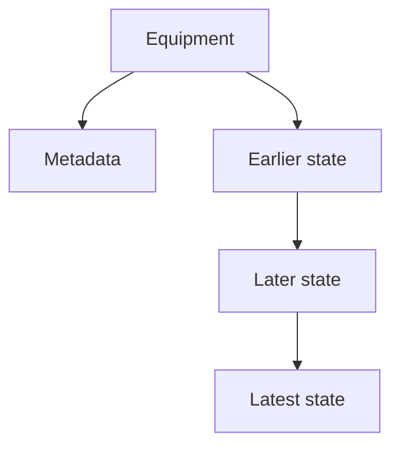

# Time-based versions

A new state is a new row. The sort key is the timestamp, so the latest state is the last timestamp in the partition.

This is the [AWS time-based version example](https://github.com/aws-samples/amazon-dynamodb-design-patterns/tree/master/examples/version-control/time-based-version), one part of the [version control sample](https://github.com/aws-samples/amazon-dynamodb-design-patterns/tree/master/examples/version-control). The script is [equipment.dql](equipment.dql). The parent model is [version control](../README.md).

## Keys

Table `aws_vc_time`. Partition key `PK`, sort key `SK`. No secondary index.

| Row | PK | SK | Other attributes |
| --- | --- | --- | --- |
| Equipment | equipment id | `Metadata` | `Name`, `FactoryID`, `LineID` |
| State | equipment id | timestamp, such as `2020-11-11T08:15:00` | `State` |

`Metadata` does not begin with a digit. State keys in this sample begin with `2`. `begins_with(SK, '2')` returns the history and leaves the metadata row out. Descending order with `LIMIT 1` is the latest state. That is the read the sample's GetLatestVersion function runs.

## Rows in the script

Equipment#1 is `EquipmentName` on factory `F#12345`, line `L#12345`. Its states are WARNING1 at 09:00, NORMAL at 10:30, and WARNING2 at 08:15 the next day. Equipment#2 is `PackingLine` on line `L#67890`, with one NORMAL reading on 12 November 2020.

## Diagram

The equipment holds metadata and a chain of states. The last state in that chain is the latest.

[Open the diagram](diagram.html). Hover a box to follow that chain. Click a box to pin it.
