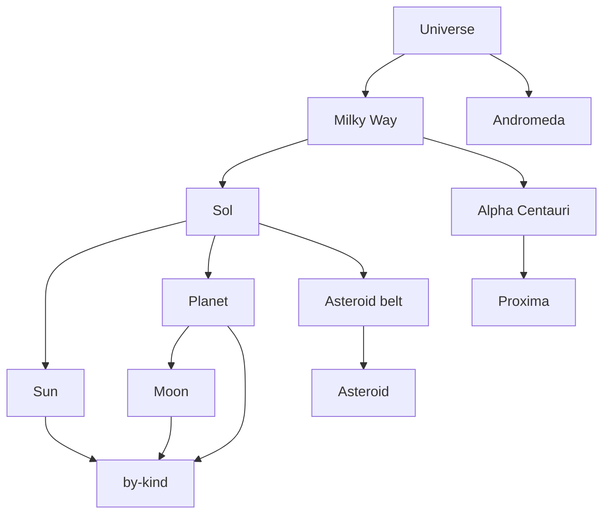

# Cosmos

One table for a universe of bodies. `pk` is the parent and `sk` is the child. The prefix on `sk` says what the child is.

Load [00-table.dql](00-table.dql), then [10-bodies.dql](10-bodies.dql). [20-queries.dql](20-queries.dql) and [30-planet-star.dql](30-planet-star.dql) are the reads.

## Keys

| Key | Attribute |
| --- | --- |
| Partition key | `pk` |
| Sort key | `sk` |
| `by-kind` | `kind`, `name` |

| Parent `pk` | Child prefix | Examples |
| --- | --- | --- |
| `UNIVERSE` | `GALAXY#` | Milky Way, Andromeda, Draco |
| `GALAXY#milky-way` | `SYSTEM#` | Sol, Alpha Centauri, Orion, Vela |
| `SYSTEM#sol` | `STAR#`, `PLANET#` | the Sun, the planets, Pluto |
| `SYSTEM#…` | `STAR#` | Rigil, Toliman, Proxima, Betelgeuse |
| a planet | `MOON#` | moons live under the planet |
| the belt | asteroid prefix | asteroids live under the belt, which lives under Sol |

`by-kind` lists one type no matter which parent holds it. Pluto is stored with the planets and typed `dwarf-planet` on that index, so a planet count on `kind = 'planet'` leaves it out.

## Diagram

The universe holds galaxies, a galaxy holds systems, and a system holds stars and planets. Moons hang off a planet. The belt hangs off Sol and holds the asteroids. Stars, planets, and moons are also copied to `by-kind`.

In the dqlrs web UI, hover a box to follow that chain, click a box to pin it, and use the full-screen button to enlarge the diagram.
