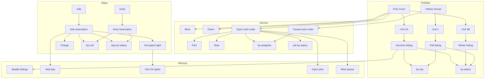

# Harbor and Pine

A small property company kept as three single-table designs. Each table uses `pk` for the parent and `sk` for the child. A prefix on `sk` says what the row is.

Run the scripts in order. [30-memory.dql](30-memory.dql) reads the tables created by the first three.

| Script | Table | What it holds |
| --- | --- | --- |
| [00-portfolio.dql](00-portfolio.dql) | `hp_portfolio` | Buildings, units, and listings |
| [10-stays.dql](10-stays.dql) | `hp_stays` | Guests, reservations, occupied nights, and charges |
| [20-service.dql](20-service.dql) | `hp_service` | Staff, work orders, parts, and notes |
| [30-memory.dql](30-memory.dql) | `hp_mem_*` | Temp copies of the five desk reads |

## Portfolio

`hp_portfolio` has indexes `by-city` (`city`, `sk`) and `by-status` (`status`, `sk`).

Pine Court is `BLDG#pine` in Seattle. Harbor House is `BLDG#harbor` in Portland. Units hang off the building: `UNIT#2a` and `UNIT#4b` at Pine Court, `UNIT#1` at Harbor House. A listing hangs off its unit. The summer listing on unit 2A is active in Seattle. The winter listing is closed. The fall listing on Harbor House is active in Portland. `city` is stored on the listing so `by-city` can find Seattle listings without walking every building.

## Stays

`hp_stays` has indexes `by-unit` (`unit_id`, `sk`) and `by-status` (`status`, `arrive`).

Ada Okonkwo and Kenji Sato each have a profile and reservations under `GUEST#`. The reservation sort key starts with the arrival date, so one guest's trips come back in order. The same stays are also written under `UNIT#2a`, one row per occupied night. Charges hang off the reservation. `by-status` lists booked stays in arrival order.

## Service

`hp_service` has indexes `by-assignee` (`assignee`, `sk`) and `by-status` (`status`, `due`).

Staff and work orders hang off the building. Mina Alvarez and Owen Blake are on Pine Court. Open jobs sort by due date. Parts and notes hang off the work order, so one query loads the ticket. `by-assignee` is one person's queue, including a job already closed. `by-status` is the open board.

## Memory

A temp table keeps the rows of one query in memory for every tab of this server. It is not written to disk, and it is gone when the process exits. The first selected column is the hash key.

| Temp table | Copied from |
| --- | --- |
| `hp_mem_seattle_listings` | Active Seattle listings on `by-city` |
| `hp_mem_ada_trips` | Ada's reservations |
| `hp_mem_unit_2a_nights` | Nights taken on unit 2A |
| `hp_mem_open_jobs` | Open work orders on `by-status` |
| `hp_mem_mina_queue` | Mina's queue on `by-assignee` |

## Diagram

A box is a row or an index. An arrow means the left side holds, or is copied into, the right side. The memory boxes are the temp tables.

In the dqlrs web UI, hover a box to follow that chain, click a box to pin it, and use the full-screen button to enlarge the diagram.
