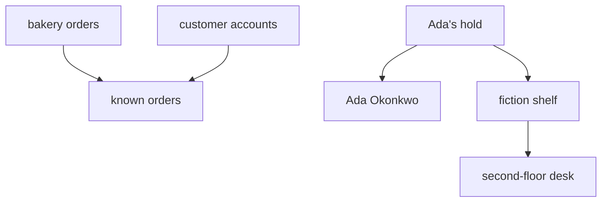

# Joins

Each script loads the sides it joins into memory, then merges those rows. A DynamoDB table is not joined until a `WITH` clause or `CREATE TEMPTABLE` has loaded it. Each side is scanned once.

| Script | What it shows |
| --- | --- |
| [memory-equijoin.dql](memory-equijoin.dql) | `WITH` loads Saturday bakery orders and customer accounts. The sourdough and the cinnamon rolls match Ada Okonkwo. The walk-in coffee does not. A second statement projects `name` for order `ord-1043`. The same tables are then kept as temp tables and joined with unqualified columns. |
| [temp-from-two-tables.dql](temp-from-two-tables.dql) | `CREATE TEMPTABLE` stores the orders that matched an account. The `WITH` names inside it disappear. `bakery_known_orders` remains. |
| [temp-from-two-temps.dql](temp-from-two-temps.dql) | The open orders and the account list are joined into a third temp table. The source temps stay. |
| [four-tables.dql](four-tables.dql) | Where is Ada Okonkwo's book, and which desk should she use? Her request joins her account, the fiction shelf on floor 2, and Priya Shah's desk by the elevators. The title is `The Left Hand of Darkness`. |
| [thousand-by-ten.dql](thousand-by-ten.dql) | 1000 grocery receipts joined to 10 departments. Pantry matches 100 receipts. Receipt `15` is in Pantry. Receipts `0` through `9` share their number with the department, so that department id is not repeated. |
| [thousand-by-thousand.dql](thousand-by-thousand.dql) | 1000 clinic visits joined to 1000 reminders on the same visit number. Visit `15` is an eye exam, and the reminder says to bring an insurance card. The numbers are equal, so the reminder's visit number is not stored again. |

A shared column keeps the left value. A different right value is stored as `righttable.column`. `WHERE` filters the left scan before the merge.

## Diagram

`WITH` copies each DynamoDB table once. The join reads those copies. A further `JOIN` extends the rows already built. `CREATE TEMPTABLE` can keep the result.

In the dqlrs web UI, hover a box to follow that chain, click a box to pin it, and use the full-screen button to enlarge the diagram.
