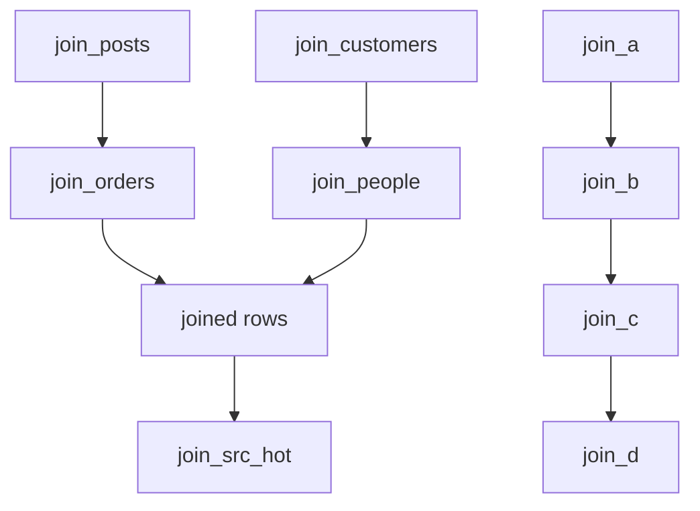

# Joins

Each script loads the sides it joins into memory, then merges those rows. A DynamoDB table is not joined until a `WITH` clause or `CREATE TEMPTABLE` has loaded it. Each side is scanned once.

| Script | What it shows |
| --- | --- |
| [memory-equijoin.dql](memory-equijoin.dql) | `WITH` loads posts and customers. Two posts match Ada. A second statement projects `name` for post `b`. The same tables are then kept as temp tables and joined with unqualified columns. |
| [temp-from-two-tables.dql](temp-from-two-tables.dql) | `CREATE TEMPTABLE` stores the join. The `WITH` names inside it disappear. `join_src_hot` remains. |
| [temp-from-two-temps.dql](temp-from-two-temps.dql) | Two temp tables are joined into a third. The source temps stay. |
| [four-tables.dql](four-tables.dql) | `join_a` to `join_d`, one equijoin after another. The row is `a`, and `label` is `end`. |
| [thousand-by-ten.dql](thousand-by-ten.dql) | 1000 rows joined to 10 buckets. Bucket `5` matches 100 rows. Row `15` carries `n5`. Rows `0` through `9` share their id with the bucket, so that right id is not repeated. |
| [thousand-by-thousand.dql](thousand-by-thousand.dql) | 1000 rows joined to 1000 rows on the same `id`. Row `15` has mark `L15` and note `R15`. The ids are equal, so the right id is not stored again. |

A shared column keeps the left value. A different right value is stored as `righttable.column`. `WHERE` filters the left scan before the merge.

## Diagram

`WITH` copies each DynamoDB table once. The join reads those copies. A further `JOIN` extends the rows already built. `CREATE TEMPTABLE` can keep the result.

In the dqlrs web UI, hover a box to follow that chain, click a box to pin it, and use the full-screen button to enlarge the diagram.
