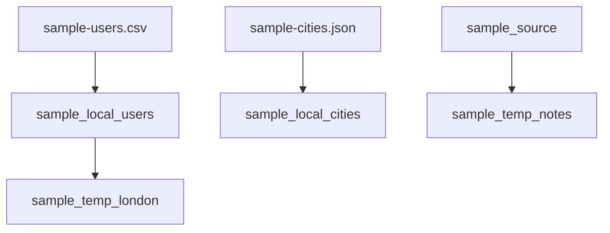

# Local and temp tables

[local-tables.dql](local-tables.dql) registers two files and two in-memory copies. Its paths start with `./`, which resolves against the folder of the `.dql` file, so they point at the files in this folder wherever `dqlrs` was started. Any other relative path resolves against the workspace (the folder `dqlrs web` was started in, or `--dir`).

## Local tables

The first column of the file is the hash key. Types are inferred from the values. A local table is read again on every query, so an edit to the file shows up on the next scan. Its definition is saved in the workspace's `.dqlrs-cache`, for the current connection, and loaded the next time `dqlrs` starts in that workspace with that connection. `DROP LOCALTABLE` forgets that definition and leaves the file on disk. `INSERT`, `UPDATE`, and `DELETE` are rejected.

| Table | File | Hash key |
| --- | --- | --- |
| `sample_local_users` | [sample-users.csv](sample-users.csv) | `id` |
| `sample_local_cities` | [sample-cities.json](sample-cities.json) | `id` |

The CSV rows are Ada in London (`id` `a`) and Grace in New York (`id` `b`).

## Temp tables

A temp table is the rows from a `SELECT` or `SCAN`. Every tab on this server sees it. Another `dqlrs` process does not. It is not saved, and it is gone when this process exits. `INSERT` into a temp table adds rows in memory only. A name cannot belong to a DynamoDB table and a local or temp table at once.

| Temp table | Source |
| --- | --- |
| `sample_temp_london` | London rows from `sample_local_users`. Later edits to the CSV do not change this snapshot. |
| `sample_temp_notes` | The `id = 'a'` row from DynamoDB table `sample_source` |

## Diagram

The files feed the local tables. The London temp table is a copy of the user file. The notes temp table is a copy of one DynamoDB row.

[Open the diagram](diagram.html). Hover a box to follow that chain. Click a box to pin it.
