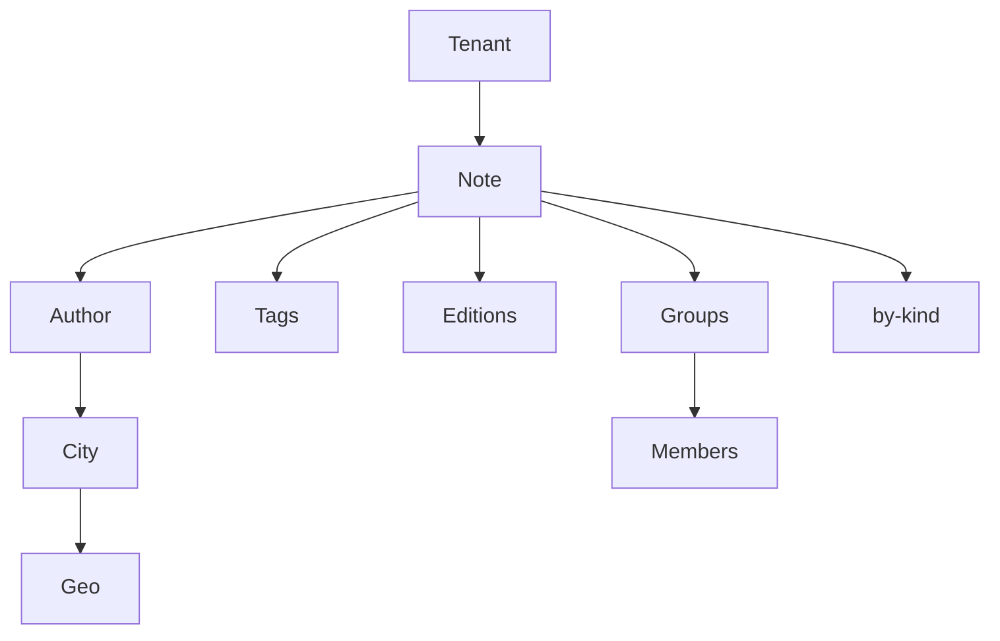

# Nested documents

Rows share a key and carry maps and lists that do not share a shape. Paths such as `author.city.name` and `tags[0].name` read into those values.

Run [00-table.dql](00-table.dql), then [10-documents.dql](10-documents.dql). [20-queries.dql](20-queries.dql) is the reads.

## Keys

| Key | Attribute |
| --- | --- |
| Partition key | `tenant` |
| Sort key | `doc_id` |
| `by-kind` | `kind`, `doc_id` |

The sample tenant is `field`. Notes `note-ada` and `note-grace` are `kind = 'note'`. `note-blank` is a sketch: the author has a name and no city, and some lists are missing or empty.

Ada's row is the full shape. `author.city` holds a name, a postal code, and `geo`. `tags` and `editions` are lists of maps. `groups` is a list of maps whose `members` is another list. `editions` on Grace's row is an empty list. A missing path and an empty list are different results in [20-queries.dql](20-queries.dql).

## Diagram

The tenant holds the note. The note holds the author, the tag list, the edition list, and the groups. The author's city holds geo. A group holds its members. The note is also copied to `by-kind`.

In the dqlrs web UI, hover a box to follow that chain, click a box to pin it, and use the full-screen button to enlarge the diagram.
