# Query scripts

Each file creates a small table and runs the statements that file is there to show. The tables do not share rows.

| Script | Table | Keys |
| --- | --- | --- |
| [catalog.dql](catalog.dql) | `sample_catalog` | `sku`, `revision`. Index `by-status` on `status`, `revision`. Rows share a key and little else. |
| [events.dql](events.dql) | `sample_events` | `device_id`, `ts`. Local index `kind-index` on `kind`. One device timeline, from a heartbeat to a crash. |
| [orders.dql](orders.dql) | `sample_orders` | `customer_id`, `order_id`. Index `by-status` on `status`, `placed_at`. Line items, money, and addresses differ by row. |
| [people.dql](people.dql) | `sample_people` | `user_id` only. Attributes are sparse: some rows are a key, some carry maps, sets, lists, or a binary avatar. |
| [posts.dql](posts.dql) | `nb_posts` | `username`, `postid`. Selects Steve's posts, then scans the table. [scans/recent.dql](../scans/recent.dql) scans this same table. |
| [functions.dql](functions.dql) | `sample_functions` | `id`, `sk`. Items under `store-1` exercise `contains`, `begins_with`, `attribute_exists`, `attribute_type`, and `size`. |
| [save-load.dql](save-load.dql) | `sample_save`, `sample_save_loaded` | `id`. A scan of `sample_save` is saved to `saved.json` and `saved.csv`, and `saved.json` is loaded into the second table. |

`just web` starts in the repository root, so `saved.json` and `saved.csv` are written there.

## Diagram

Each group is one script. An arrow is the key order, the nested values, or the file the scan writes.

```mermaid
flowchart TD
  subgraph catalog [Catalog]
    sku["SKU"]
    revision["Revision"]
    catStatus["by-status"]
    sku --> revision
    revision --> catStatus
  end
  subgraph events [Events]
    device["Device"]
    eventRow["Event"]
    eventKind["kind-index"]
    device --> eventRow
    eventRow --> eventKind
  end
  subgraph orders [Orders]
    customer["Customer"]
    order["Order"]
    lines["Lines and address"]
    orderStatus["by-status"]
    customer --> order
    order --> lines
    order --> orderStatus
  end
  subgraph people [People]
    person["Person"]
    profile["Sparse attributes"]
    person --> profile
  end
  subgraph posts [Posts]
    username["Username"]
    post["Post"]
    username --> post
  end
  subgraph fns [Condition functions]
    store["Store"]
    item["Item"]
    store --> item
  end
  subgraph saved [Save and load]
    saveRow["sample_save"]
    jsonFile["saved.json"]
    loaded["sample_save_loaded"]
    saveRow --> jsonFile
    jsonFile --> loaded
  end
```

[Open the diagram](diagram.html). Hover a box to follow that chain. Click a box to pin it.
