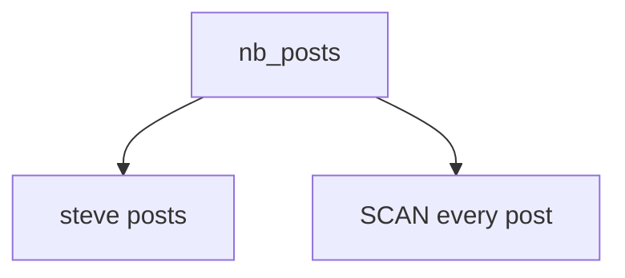

# Scans

[recent.dql](recent.dql) is one statement:

```sql
SCAN * FROM nb_posts;
```

`nb_posts` is created in [queries/posts.dql](../queries/posts.dql). The hash key is `username` and the sort key is `postid`. That file also selects `username = 'steve'`, which reads one partition. The scan here reads every post, across usernames.

Load the posts script before this one. The scan has no key condition, so it is the read that walks the whole table.

## Diagram

The table holds each username's posts. The scan reads all of them.



In the dqlrs web UI, hover a box to follow that chain, click a box to pin it, and use the full-screen button to enlarge the diagram.
