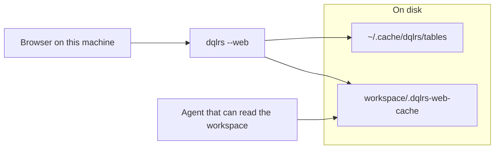

# Security plans

**Status:** done. Every plan here has shipped. They are kept as the record of
the design. "Today" columns inside them describe the code before the work.

What shipped:

- Both caches are AES-256-GCM ciphertext on disk, directories `0700` and files
  `0600`. Plaintext files from older versions are rewritten in place.
- One key per OS user, in the Mac login keychain, Windows DPAPI, Linux Secret
  Service, or a `0600` file (Linux without a keyring, WSL).
- A per-user token, stored as its own item in the same stores, guards `/api/*`,
  `/mcp`, and TCP `--serve`. The page gets it from a `<meta>` tag. Stdio
  `--serve` needs none.
- Listen addresses stay loopback-only.

Platform-store tests skip when the store is absent, so the Mac keychain and
Windows DPAPI paths are covered here by the store-selection test only.

The query-result cache stays in the workspace, at
`<workspace>/.dqlrs-web-cache/`. Encryption and file mode protect those files
where they are.

| Group | Document | What it covers |
| --- | --- | --- |
| Product | [`prd.md`](prd.md) | Threats, requirements, phases, decisions |
| Disk | [`disk-caches.md`](disk-caches.md) | Table-definition cache and query-result cache |
| Keys | [`encryption-and-keys.md`](encryption-and-keys.md) | Cipher, cost, Mac, Windows, Linux, WSL |
| API | [`local-api.md`](local-api.md) | Loopback web API, `/mcp`, and `dqlrs --serve` |
| Agents | [`agents.md`](agents.md) | Workspace readers and same-user processes |

