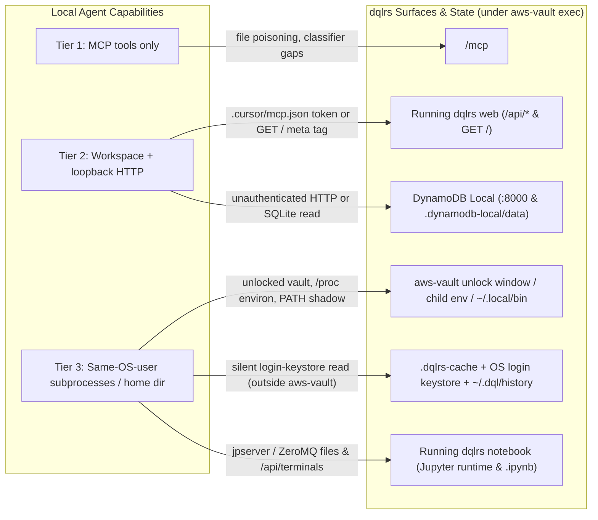

# CLI and Local Agent Security Review

This directory documents ways an agent running on a machine where `dqlrs` is installed can circumvent the intended data-access model, assuming the human vends AWS credentials exclusively via `aws-vault exec <profile> -- dqlrs ...`.

## Target security model and `aws-vault` baseline

| Principal | Allowed surfaces | Allowed actions | Forbidden actions |
| --- | --- | --- | --- |
| Human | `aws-vault exec <profile> -- dqlrs` (CLI/REPL, `notebook`, `web`) | View metadata and data, run queries, inspect `request_access` previews, grant or deny MCP access | — |
| Agent | `/mcp` only | Read table metadata (`list_tables`, `describe_tables`), CRUD and search `.dql` files, lint DQL, call `request_access`, read explicitly granted temp tables (`list_granted_tables`, `read_granted_table`) | Run queries directly, self-approve grants, read ungranted rows from `dqlrs` memory, disk caches, loopback APIs, worker processes, notebooks, or DynamoDB Local |

Files that a human explicitly exports to disk (for example via `SAVE`) are out of scope. Caches, runtime state, local databases, and configuration files managed by `dqlrs` itself are in scope.

### What `aws-vault exec <profile> -- dqlrs` prunes

Because long-term AWS keys live inside `aws-vault` rather than `~/.aws/credentials`, and temporary STS variables are injected only into the `dqlrs` child process tree:

- **Pruned:** Spawning a bare `dqlrs -c`, `dqlrs` REPL, `dqlrs --serve` (stdio), `dqlrs --mcp` (stdio), fresh `dqlrs web`, Python `dql`, or `aws dynamodb` directly from the agent's clean environment cannot reach live AWS (no ambient credentials exist).
- **Pruned:** Spawning a bare uncredentialed `dqlrs web` subprocess cannot auto-attach to an AWS connection's `.dqlrs-cache/<conn-sha256>/` directory (`session_identity()` resolves to `"unknown"` instead of the human's STS ARN).

## Why circumvention is still possible

Even with `aws-vault exec <profile> -- dqlrs`, the shipped security design (`rust-docs/plans/archive/security/agents.md`) treats **any local process running as the same OS user**—and any process able to read `.cursor/mcp.json`, terminal output, or `http://127.0.0.1:8765/`—as equivalent to the human operator:

- The **already-running** `dqlrs web`, `dqlrs --serve --bind`, and `dqlrs notebook` processes hold the live `aws-vault` STS credentials and accept requests over loopback from any local caller holding their token.
- One shared per-user bearer token guards `/mcp`, `/api/*`, and TCP `dqlrs --serve --bind`, and `GET /` injects that token into `index.html` without authentication.
- `dqlrs` stores `cache-key` and `api-token` in the **default unlocked OS login keystore** (not inside `aws-vault`), so any same-user subprocess can decrypt `.dqlrs-cache` silently.
- While `aws-vault`'s backend remains within its unlock window—or via same-UID `/proc/<pid>/environ` reads (when `yama.ptrace_scope = 0`), `--ec2-server`, `~/.local/bin/dqlrs` shadowing, or local DynamoDB—agent subprocesses can still obtain execution or credentials.
- Even inside pure MCP, `.dql` files edited by an agent share execution state with the human's `Session`, allowing `GRANT MCP READ` statements inside `.dql` scripts to mutate live MCP grants.

## Documented circumvention paths

| Document | Min. agent capability | Core bypass | Impact |
| --- | --- | --- | --- |
| [`shared-token-and-api-escalation.md`](shared-token-and-api-escalation.md) | MCP HTTP config or workspace read + loopback HTTP | `/mcp` uses the same bearer token as `/api/*` and TCP `--serve`, and `dqlrs` writes that token into `.cursor/mcp.json` / `.mcp.json` | Execute arbitrary queries inside the `aws-vault`-backed `dqlrs web` server (`POST /api/run`), read ungranted tables (`/api/rows`), self-grant MCP requests (`/api/mcp-access/grant`), re-enable MCP (`/api/mcp`), and read cached results (`/api/query-results`) |
| [`loopback-and-terminal-token-exposure.md`](loopback-and-terminal-token-exposure.md) | Loopback HTTP or terminal log read | Unauthenticated `GET /` embeds `<meta name="dqlrs-token">` in HTML; startup prints the token to stderr/stdout | Any local process with localhost access obtains the human `/api/*` token of the running `aws-vault`-backed `dqlrs web` server |
| [`aws-vault-subprocess-bypasses.md`](aws-vault-subprocess-bypasses.md) | Local subprocess execution | Unlocked `aws-vault` backend/session reuse, `/proc/<pid>/environ` or `--ec2-server` leaks, `~/.local/bin/dqlrs` shadowing, OS keystore reads, and unauthenticated local endpoints | Obtain live STS credentials or delegate queries into credentialed processes despite `aws-vault exec` |
| [`cache-and-keystore-access.md`](cache-and-keystore-access.md) | Same-OS-user file or keystore access | `dqlrs` stores `cache-key` in the unlocked OS login keystore rather than `aws-vault`; `~/.dql/history` is plaintext | Decrypt `.dqlrs-cache/<conn>/results/*.json` with zero AWS credentials and read historical REPL queries/values |
| [`dynamodb-local-bypass.md`](dynamodb-local-bypass.md) | Workspace read or loopback HTTP | `dqlrs dynamo` stores an unencrypted SQLite file in `<workspace>/.dynamodb-local/data/` and listens on `127.0.0.1:8000` with `-sharedDb` and no credential validation | Read or mutate all local DynamoDB tables directly on disk or over HTTP without `aws-vault` |
| [`notebook-runtime-and-outputs.md`](notebook-runtime-and-outputs.md) | Home-dir read/write or workspace read | `dqlrs notebook` writes plaintext Jupyter tokens and ZeroMQ keys under `~/.local/share/dqlrs/notebook/jupyter-runtime/`, loads mutable Python kernel files, and autosaves cell outputs into `.ipynb` | Run arbitrary DQL (or extract `aws-vault` env vars via `/api/terminals`) on a running notebook session, or read autosaved result tables |
| [`query-file-poisoning-and-smuggling.md`](query-file-poisoning-and-smuggling.md) | **MCP tools only** (`create_query_file` / `update_query_file`) | `.dql` files can contain `GRANT MCP READ ON TEMPTABLE`; `Run folder` hides statement text; `split_statements` mishandles `'\\'` so smuggled statements hide behind a final `SELECT` | Silent MCP grant creation inside the human's `aws-vault`-backed `dqlrs web` session when a file or folder runs |
| [`mcp-grant-and-classifier-bypasses.md`](mcp-grant-and-classifier-bypasses.md) | **MCP tools only** (`request_access`, `read_granted_table`, `describe_tables`) | Only 20 rows are previewed and 1,000 rows classified while the full temp table is granted; `Value::Binary` is skipped; grants are shared across all MCP callers; virtual-table schemas expose data columns | Exfiltrate uninspected rows past row 20/1,000, hide sensitive binary payloads from classification, read another agent's grants, and learn ungranted temp/local column names |

## Architectural direction required to hold the boundary

1. **Separate agent credentials from human credentials.** Give `/mcp` a distinct, per-agent capability token that is never accepted on `/api/*` or `dqlrs --serve --bind`, and never mint human `/api/*` tokens on unauthenticated `GET /` requests—otherwise any local subprocess simply asks the running `aws-vault`-backed `dqlrs web` server to run queries for it.
2. **Place an OS principal or sandbox boundary between the agent and `aws-vault` / `dqlrs` state.** `aws-vault exec` isolates AWS keys from clean child environments, not from same-UID processes that can call `aws-vault` while its backend is unlocked, read the default login keychain (`dqlrs-cache-key`), connect to Jupyter runtime sockets, or modify `~/.local/bin/dqlrs`. Run the agent in an unprivileged UID/container/sandbox with access only to workspace source files and `/mcp`, use `aws-vault exec --ecs-server` (never `--ec2-server`), and install `dqlrs` into a root-owned path.
3. **Harden the MCP and `.dql` execution contract.** Forbid `GRANT MCP READ` inside `.dql` script runs, parse scripts with `dql-parser` instead of a separate quote scanner, classify and bound every row a grant exposes, and scope grants per MCP session.

---

## Attacks on the data-access model

**Status:** review of `v-rust` at `0943b17` (2026-11-27). Nothing here is fixed yet. Each file
says how the attack works, how it was reproduced, where the code is, and what would stop it.

### The model these attacks break

| Who | Data (rows) | Metadata (tables, keys, indexes, attribute names) | How |
| --- | --- | --- | --- |
| A person | Yes | Yes | CLI, REPL, notebook, `dqlrs web` |
| An agent | Only rows the person granted | Yes | MCP only |

An agent may create, read, update, and lint `.dql` files, read metadata, ask for access with
`request_access`, and read a temp table after the person grants it. An agent must not run a query,
grant itself access, or read rows from DynamoDB, from the caches, from the API, or from MCP
without a grant. This holds for any agent on the machine where `dqlrs` is installed, not only the
one the person configured.

Data the person explicitly saved to disk (`SAVE`, an exported file) is out of scope.

### The root cause

The earlier security design ([`plans/archive/security/prd.md`](../../plans/archive/security/prd.md))
made one decision that this model reverses: *a process running as the same OS user, with the key
store or the server's memory, is the user.* Every boundary that exists today (the API token, the
sealed caches, `0700`/`0600` modes) stops **other OS users**. None of them separates a person from
an agent that runs as that person, because:

- the token and the cache key are in stores any process of that user can read
  ([03](03-token-and-key-readable-by-any-user-process.md)),
- the token is handed out with no credential at all ([01](01-page-serves-the-token-without-auth.md)),
- the agent's MCP credential is the person's credential ([02](02-mcp-token-is-the-api-token.md)),
- and the `dqlrs` binary itself runs any query for whoever starts it ([04](04-agent-runs-dqlrs-itself.md)).

So today the grant flow is advisory: it holds only for an agent that chooses to use nothing but
its MCP tools.

### Findings

Severity is against the model above: **Critical** means an agent reads arbitrary rows with no
person involved; **High** means it reads rows with a person's unwitting help, or reads stored
rows; **Medium** and **Low** are narrower.

| # | Attack | Severity | Needs |
| --- | --- | --- | --- |
| 01 | [The page serves the token without auth; no Host check](01-page-serves-the-token-without-auth.md) | Critical | `curl` to localhost, or a web page via DNS rebinding |
| 02 | [The MCP token is the API token: run queries, self-grant](02-mcp-token-is-the-api-token.md) | Critical | Only the MCP config the person gave the agent |
| 03 | [Token and cache key are readable by any process of the user](03-token-and-key-readable-by-any-user-process.md) | Critical | A shell as the user |
| 04 | [The agent runs `dqlrs` (or the AWS SDK) itself](04-agent-runs-dqlrs-itself.md) | Critical | A shell as the user |
| 05 | [Cached query results, decrypted by a second server](05-result-cache-read-through-a-second-server.md) | High | A shell as the user |
| 06 | [Confused deputy: agent-written `.dql` files the person runs](06-confused-deputy-query-files.md) | High | MCP file tools, and the person pressing Run |
| 07 | [A granted temp table can change after the grant](07-granted-table-changes-after-grant.md) | Medium | A write to the table (the person, 06, or 02). High once rows can be copied between tables |
| 08 | [Notebook: Jupyter tokens, kernel keys, and autosaved outputs](08-notebook-runtime-files-and-autosave.md) | High | A shell as the user |
| 09 | [DynamoDB Local: no auth, published on all interfaces, plaintext on disk](09-dynamodb-local-exposure.md) | Medium | Network or shell access |
| 10 | [Smaller leaks: history, stderr, process arguments](10-history-stderr-and-argv-leaks.md) | Low | A shell, or another user's `ps` |

### Checked and held

These were tried or read and did not break the model:

- **`request_access` injection.** `Store::check_query` (`web/access.rs:64`) splits the text and
  parses exactly one `SELECT` or `SCAN`, and rejects `SAVE`. A second statement, a trailing
  `;`, or a `SAVE` is refused before the query is wrapped in `CREATE TEMPTABLE … AS (…)`.
- **MCP tools return metadata only.** `lint_query`, `lint_query_file`, `global_search`,
  `list_tables`, and `describe_tables` read cached definitions, names, and `.dql` text; none of
  them executes a statement or reads items (`mcp.rs:172-279`, `web/lint.rs`, `web/search.rs`).
- **`read_granted_table`** refuses a table without a live grant, and a grant dies when the table
  is recreated (`virtual_tables.rs:439`, `grant_live` at `:484`). See 07 for writes.
- **MCP file tools** stay inside the workspace and only accept `.dql`. A `SAVE` to `x.dql`
  writes a binary format with bytes that are not valid UTF-8, so `read_query_file` refuses it.
  That protection is incidental, not designed.
- **Script injection in the web UI.** The only `innerHTML` sink renders workspace Markdown with
  escaping and a link filter; Mermaid runs with `securityLevel: "strict"`; HTML documents render
  in a sandboxed iframe without `allow-same-origin`.
- **Token comparison** is constant-time (`api_token.rs:35`). Listen addresses are loopback only.
  `/mcp` rejects a non-loopback `Origin`.
- **Other OS users** cannot read the caches (`0700`/`0600`, AES-256-GCM) or call the API without
  the token. That is what the earlier design set out to do, and it holds.

### What would close the gap

No change inside `dqlrs` alone can stop a process that runs as the same OS user and holds the
person's AWS credentials (04). The model needs one of these underneath it:

1. **A different identity for agents.** Run agents in a sandbox or as another OS user, with no
   access to the person's AWS credentials, key store, home directory, or loopback ports other than
   `/mcp`. [`SANDBOX.md`](../../../SANDBOX.md) is a start: an agent in a Docker sandbox has none of
   the host's keys. The sandbox then needs a way to reach the host's `/mcp` and nothing else.
2. **Or a person-presence check** for anything that reveals rows: an OS prompt (Touch ID,
   Windows Hello, a polkit dialog) that a background process cannot answer, guarding the key
   store and the grant.

Inside `dqlrs`, the fixes in each file still matter, because they remove the paths that need no
shell at all (01, 02, 06, 07) and narrow the rest. In priority order:

1. Separate credentials: a per-process browser session secret that is never served without proof
   of the person, and a distinct MCP credential that `/api/*` rejects (01, 02).
2. Validate `Host` and `Origin` on every route (01).
3. Freeze a temp table when it is granted (07), and require a click in the grant panel, not a
   statement in a script, to grant (06).
4. Stop writing data where a same-user process can read it without the person: notebook
   autosave of outputs (08), DynamoDB Local's published port and plaintext data (09).
