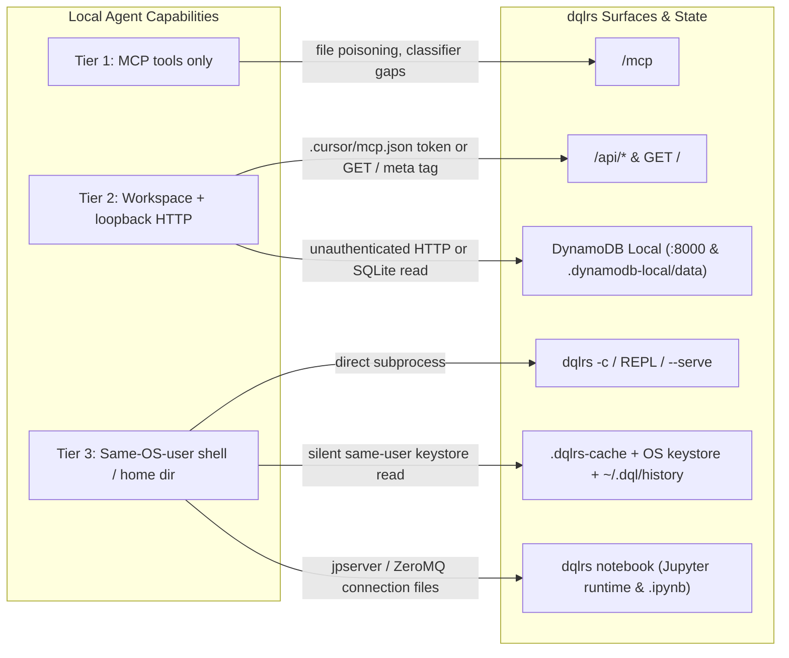

# CLI and Local Agent Security Review

This directory documents ways an agent running on a machine where `dqlrs` is installed can circumvent the intended data-access model.

## Target security model

| Principal | Allowed surfaces | Allowed actions | Forbidden actions |
| --- | --- | --- | --- |
| Human | `dqlrs` CLI/REPL, `dqlrs notebook`, `dqlrs web` | View metadata and data, run queries, inspect `request_access` previews, grant or deny MCP access | — |
| Agent | `/mcp` only | Read table metadata (`list_tables`, `describe_tables`), CRUD and search `.dql` files, lint DQL, call `request_access`, read explicitly granted temp tables (`list_granted_tables`, `read_granted_table`) | Run queries directly, self-approve grants, read ungranted rows from `dqlrs` memory, disk caches, loopback APIs, worker processes, notebooks, or DynamoDB Local |

Files that a human explicitly exports to disk (for example via `SAVE`) are out of scope. Caches, runtime state, local databases, and configuration files managed by `dqlrs` itself are in scope.

## Why circumvention is currently possible: threat-model mismatch

The shipped security design (`rust-docs/plans/archive/security/agents.md`) treated **any process running as the same OS user**—and any process able to read `.cursor/mcp.json`, terminal output, or `http://127.0.0.1:8765/`—as equivalent to the human operator:

- One shared per-user bearer token guards `/mcp`, `/api/*`, and TCP `dqlrs --serve --bind`.
- `GET /` injects that token into `index.html` without authentication so the browser can boot.
- OS keystore entries (`cache-key` and `api-token`) unlock silently for any process running under the user's login session.
- `dqlrs`, `dqlrs --serve` (stdio), `dqlrs dynamo`, and `dqlrs notebook` trust any local caller in the same OS user account.
- Even inside pure MCP, `.dql` files edited by an agent share execution state with the human's `Session`, allowing `GRANT MCP READ` statements inside `.dql` scripts to mutate live MCP grants.

## Documented circumvention paths

| Document | Min. agent capability | Core bypass | Impact |
| --- | --- | --- | --- |
| [`shared-token-and-api-escalation.md`](shared-token-and-api-escalation.md) | MCP HTTP config or workspace read + loopback HTTP | `/mcp` uses the same bearer token as `/api/*` and TCP `--serve`, and `dqlrs` writes that token into `.cursor/mcp.json` / `.mcp.json` | Run arbitrary queries (`POST /api/run`), read ungranted tables (`/api/rows`), self-grant MCP requests (`/api/mcp-access/grant`), re-enable MCP (`/api/mcp`), and read cached results (`/api/query-results`) |
| [`loopback-and-terminal-token-exposure.md`](loopback-and-terminal-token-exposure.md) | Loopback HTTP or terminal log read | Unauthenticated `GET /` embeds `<meta name="dqlrs-token">` in HTML; startup prints the token to stderr/stdout | Any local process with localhost access obtains the full human `/api/*` and `--serve` bearer token with no prior secret |
| [`cli-and-worker-execution.md`](cli-and-worker-execution.md) | Local subprocess execution | `dqlrs -c`, REPL, `dqlrs --serve` (unauthenticated stdio), and secondary `dqlrs web` processes require no human-presence check and inherit ambient AWS credentials | Direct query execution and data extraction bypassing `dqlrs web` and MCP completely |
| [`cache-and-keystore-access.md`](cache-and-keystore-access.md) | Same-OS-user file or keystore access | OS keystore backends release `cache-key` and `api-token` silently to any same-user process; `~/.dql/history` is plaintext | Decrypt `.dqlrs-cache/<conn>/results/*.json` (or spawn `dqlrs web` to decrypt it) and read historical human queries and row payloads |
| [`dynamodb-local-bypass.md`](dynamodb-local-bypass.md) | Workspace read or loopback HTTP | `dqlrs dynamo` stores an unencrypted SQLite file in `<workspace>/.dynamodb-local/data/` and listens on `127.0.0.1:8000` with `-sharedDb` and no real auth | Read or mutate all local DynamoDB tables directly on disk or over HTTP |
| [`notebook-runtime-and-outputs.md`](notebook-runtime-and-outputs.md) | Home-dir read/write or workspace read | `dqlrs notebook` writes plaintext Jupyter tokens and ZeroMQ kernel keys under `~/.local/share/dqlrs/notebook/jupyter-runtime/`, loads mutable Python kernel files, and autosaves cell outputs into `.ipynb` | Execute arbitrary DQL through the live notebook kernel or read autosaved result tables |
| [`query-file-poisoning-and-smuggling.md`](query-file-poisoning-and-smuggling.md) | **MCP tools only** (`create_query_file` / `update_query_file`) | `.dql` files can contain `GRANT MCP READ ON TEMPTABLE`; `Run folder` hides statement text; `split_statements` mishandles `'\\'` so smuggled statements hide behind a final `SELECT` | Silent MCP grant creation when a human runs a `.dql` file or folder |
| [`mcp-grant-and-classifier-bypasses.md`](mcp-grant-and-classifier-bypasses.md) | **MCP tools only** (`request_access`, `read_granted_table`, `describe_tables`) | Only 20 rows are previewed and 1,000 rows classified while the full temp table is granted; `Value::Binary` is skipped; grants are shared across all MCP callers; virtual-table schemas expose data columns | Exfiltrate uninspected rows past row 20/1,000, hide sensitive binary payloads from classification, read another agent's grants, and learn ungranted temp/local column names |

## Architectural direction required to hold the boundary

1. **Separate agent credentials from human credentials.** Give `/mcp` a distinct, per-agent capability token that is never accepted on `/api/*` or `dqlrs --serve --bind`, and never mint human `/api/*` tokens on unauthenticated `GET /` requests.
2. **Isolate data-bearing execution and storage across an OS boundary.** If an untrusted coding agent executes shell commands as the same OS user, OS file permissions and login-unlocked keychains cannot stop it from invoking `dqlrs`, reading `~/.aws`, or querying `cache-key`. Either run the agent in an unprivileged OS user/container/sandbox that only sees the workspace and an authenticated `/mcp` socket, or move `dqlrs` execution, caches, local DynamoDB storage, and AWS credentials into a separate daemon/helper guarded by interactive user presence.
3. **Harden the MCP and `.dql` execution contract.** Forbid `GRANT MCP READ` inside `.dql` script runs, parse scripts with `dql-parser` instead of a separate quote scanner, classify and bound every row a grant exposes, and scope grants per MCP session.
