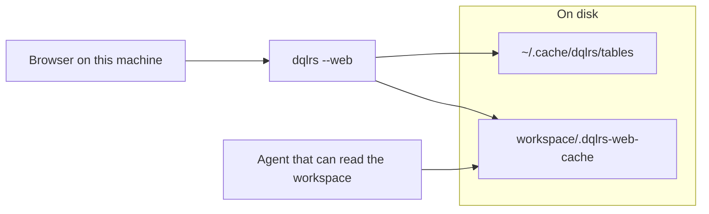

# Security plans

Plans only. No code in this set.

The query-result cache stays in the workspace, at
`<workspace>/.dqlrs-web-cache/`. Encryption and file mode protect those files
where they are.

| Group | Document | What it covers |
| --- | --- | --- |
| Product | [`prd.md`](prd.md) | Threats, requirements, phases, decisions |
| Disk | [`disk-caches.md`](disk-caches.md) | Table-definition cache and query-result cache |
| Keys | [`encryption-and-keys.md`](encryption-and-keys.md) | Cipher, cost, Mac, Windows, Linux, WSL |
| API | [`local-api.md`](local-api.md) | Loopback web API, `/mcp`, and `dqlrs --serve` |
| Agents | [`agents.md`](agents.md) | Workspace readers and same-user processes |

